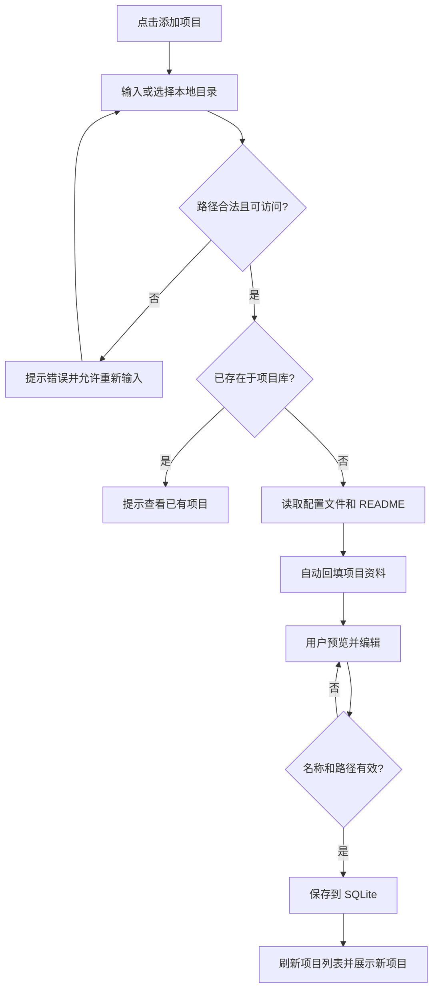

# ProjectHub 本地项目管理工具设计方案

> 版本：V1.0  
> 平台：Windows 10/11  
> 产品定位：轻量化本地代码项目导航与管理桌面应用  
> 核心原则：**只维护项目索引及元数据，不移动、不复制、不修改项目源文件**。

## 1. 项目背景与目标

开发者的代码项目可能分散在不同磁盘和目录中，查找项目、识别技术栈、回忆项目用途以及打开相应 IDE 都需要耗费时间。ProjectHub 将这些本地项目统一整理为可搜索、可分类、可快速启动的项目库。

### 1.1 核心目标

1. 通过**输入或粘贴本地文件夹路径**快速录入项目，也支持选择文件夹。
2. 自动读取项目目录中的常见配置文件和 README，生成可编辑的项目信息。
3. 以卡片或列表方式展示项目名称、简介、技术栈、路径和最近打开时间。
4. 支持项目搜索、分类、标签、收藏和最近打开。
5. 一键通过 VS Code、IntelliJ IDEA、Cursor、终端或文件资源管理器打开项目。
6. 本地离线可用，使用 SQLite 保存项目管理数据；后续按需扩展 Git 与 AI 能力。

### 1.2 非目标（V1 不实现）

- 不托管代码、不替代 Git 或 IDE。
- 不上传源代码、不强制连接云服务。
- 不执行自动构建或依赖安装。
- 不提供 Codex 真实用量/会话进度监控（可作为后续独立扩展）。

## 2. 目标用户与使用场景

面向同时维护多个 Java、Vue/React、Python、AI 智能体及工具类项目的 Windows 开发者。

典型流程：打开 ProjectHub → 搜索 `env-agent` → 查看简介、技术栈和路径 → 点击“在 IDEA 中打开”。

另一场景：在“添加项目”对话框中粘贴 `D:\Projects\env-agent-backend` → 系统验证路径并识别 `pom.xml`、`README.md` → 用户确认或补充简介 → 保存到项目库。

## 3. 功能模块

| 模块 | 功能 | 优先级 |
| --- | --- | --- |
| 项目录入 | 输入/粘贴路径、选择文件夹、路径校验、自动识别、保存 | P0 |
| 项目展示 | 卡片/列表、名称、简介、标签、路径、最近打开 | P0 |
| 全局检索 | 按名称、简介、路径、技术栈、标签模糊搜索 | P0 |
| 项目组织 | 分类、收藏、最近打开、项目详情编辑 | P0 |
| 快捷启动 | 文件管理器、终端、指定 IDE 启动 | P0 |
| 本地存储 | SQLite 数据持久化、配置保存 | P0 |
| 自动扫描 | 选择根目录，批量发现潜在项目、预览后导入 | P1 |
| Git 信息 | 分支、远程地址、工作区状态、最近提交 | P1 |
| AI 增强 | 自动编写简介、模块总结、项目问答 | P2 |
| 开发工作台 | 启动脚本、Codex 快捷入口、任务管理 | P2 |

## 4. 页面与交互设计

### 4.1 主界面

采用三栏布局：

- **左侧导航（约 220 px）**：首页、我的项目、最近打开、收藏项目、分类、标签管理、设置。
- **中间内容区（自适应）**：顶部全局搜索、分类/排序筛选、卡片/列表切换、项目列表。
- **右侧详情区（约 350 px，可收起）**：当前选中项目的简介、技术栈、路径、Git 信息及快捷操作。

顶部工具栏包含全局搜索（快捷键 `Ctrl+K`）、“+ 添加项目”和设置入口。

项目卡片展示：项目名、两行简介、技术栈标签、绝对路径（过长省略）、最近打开时间、收藏按钮、更多菜单；点击卡片查看详情，双击可使用默认 IDE 打开（支持配置）。

### 4.2 添加项目弹窗（关键功能）

字段：

| 字段 | 必填 | 说明 |
| --- | --- | --- |
| 本地项目路径 | 是 | 输入/粘贴 Windows 绝对路径，也可选择文件夹 |
| 项目名称 | 是 | 默认从文件夹名推断，可编辑 |
| 项目简介 | 否 | 优先提取 README 内容摘要，可编辑 |
| 项目分类 | 否 | 后端/前端/AI/工具/学习/其他，默认“其他” |
| 技术栈标签 | 否 | 自动识别后可增删修改 |
| 收藏 | 否 | 可在录入时标记 |
| 默认打开工具 | 否 | 系统默认/IDEA/VS Code/Cursor/自定义 |

**交互步骤：**

1. 点击“+ 添加项目”。
2. 输入或粘贴目录，如 `D:\Projects\env-agent-backend`，或点击“浏览”选择文件夹。
3. 点击“识别项目”（也可在停止输入后防抖触发）；显示校验与扫描状态。
4. 校验目录：路径格式、是否存在、是否为目录、是否可读取、是否已录入。
5. 如校验通过，有限深度读取根目录配置文件及 README，回填名称、简介、技术栈等字段。
6. 用户编辑或补充信息，点击“保存项目”。
7. SQLite 事务保存成功，关闭弹窗、刷新列表并定位新项目。

**失败与边界情况：**

- 路径不存在、无访问权限：阻止保存并提供可理解的提示。
- 路径已录入：提示“查看已有项目”，不生成重复记录。
- 识别不到技术栈：允许按普通目录手动录入。
- README 不存在或解析失败：简介保持空白，不影响保存。
- 磁盘暂时离线：已有项目仍显示“路径不可用”，不自动删除。
- 对路径做规范化比较（大小写不敏感、统一分隔符、处理尾部斜杠）；符号链接/联接点应尽可能解析以避免重复，并注意循环遍历。

### 4.3 项目详情

内容分组：

- 基础信息：名称、简介、路径、分类、标签、收藏、备注。
- 技术信息：语言、框架、数据库、构建工具。
- 文件信息：添加时间、最近打开时间、项目目录是否可用。
- Git 信息（P1）：仓库 URL、当前分支、未提交更改、最近提交时间。
- 快捷操作：在默认 IDE 打开、选择其他 IDE 打开、终端打开、资源管理器显示、复制路径、打开 README、编辑信息、从项目库移除。

“从项目库移除”**仅删除索引记录，不删除本地文件**。需在确认框中明确强调这一点。

### 4.4 设置页面

- 默认 IDE 与可执行程序路径。
- 新项目默认分类。
- 项目展示方式、浅色/深色主题。
- 数据库文件位置、导出/导入备份。
- 是否启用开机自启、系统托盘常驻（可选）。
- 后续支持自动扫描目录配置与 AI 模型配置。

## 5. 项目识别规则

只进行本地**只读**分析，先判断根目录中的特征文件：

| 检测文件 | 推测信息 |
| --- | --- |
| `pom.xml` | Java / Maven；根据依赖判断 Spring Boot、Spring AI Alibaba 等 |
| `build.gradle` / `build.gradle.kts` | Gradle / Java 或 Kotlin |
| `package.json` | Node.js；根据依赖识别 Vue、React、Vite、Next.js 等 |
| `requirements.txt` / `pyproject.toml` | Python及依赖框架 |
| `Cargo.toml` | Rust |
| `go.mod` | Go |
| `.sln` / `.csproj` | .NET / C# |
| `.git` | Git 仓库（目录或 gitfile） |
| `README.md` | 提取标题与内容摘要作为项目说明候选 |

规则：允许一个项目有多个技术栈；未知类型不阻止录入；自动推断结果始终可人工覆盖。默认仅读取项目根目录与少量已知配置文件，限制读取字节数和解析耗时，避免递归扫描 `node_modules`、`.git/objects`、`target`、`dist` 等大型目录。绝不执行仓库脚本或 README 中的命令。

## 6. 技术架构

**建议技术栈：** Tauri 2 + React + TypeScript + Vite + SQLite + Rust。

```text
┌──────────────────────────────────────────────┐
│ Windows 桌面 UI (React + TypeScript)           │
│ 搜索 / 项目卡片 / 编辑弹窗 / 项目详情 / 设置      │
└─────────────────────┬────────────────────────┘
                      │ Tauri Commands / Events
┌─────────────────────▼────────────────────────┐
│ Tauri 2 / Rust 本地能力层                       │
│ 路径验证 / 文件识别 / IDE 启动 / Git 读取         │
│ 项目服务 / 配置服务 / SQLite 持久化              │
└──────────────┬────────────────┬──────────────┘
               │                │
        ┌──────▼───────┐  ┌─────▼──────────────┐
        │ SQLite 数据库 │  │ 本地项目目录(只读扫描)│
        └──────────────┘  └────────────────────┘
```

无需独立 Spring Boot 服务或 MySQL。前端负责交互，后端本地能力层负责文件系统访问、数据库操作和外部程序启动。外部路径、命令参数均需严格校验，避免将原始用户输入拼接成 Shell 命令。

### 6.1 推荐模块目录

```text
projecthub/
├── src/
│   ├── pages/           # 首页、项目列表、设置
│   ├── components/      # ProjectCard、ProjectDetail、AddProjectDialog
│   ├── hooks/
│   ├── services/        # 封装 Tauri invoke
│   ├── stores/
│   ├── types/
│   └── styles/
├── src-tauri/
│   └── src/
│       ├── commands/    # 项目和设置命令
│       ├── services/    # 扫描、识别、IDE 启动
│       ├── db/          # SQLite、迁移及 DAO
│       └── lib.rs
└── README.md
```

## 7. 数据结构设计

建议从一张主表起步，分类和技术栈列表先使用 JSON 文本字段，后续需要复杂统计时再拆分关联表。

```sql
CREATE TABLE IF NOT EXISTS projects (
    id TEXT PRIMARY KEY,
    name TEXT NOT NULL,
    path TEXT NOT NULL UNIQUE,
    description TEXT NOT NULL DEFAULT '',
    category TEXT NOT NULL DEFAULT 'other',
    tags_json TEXT NOT NULL DEFAULT '[]',
    tech_stack_json TEXT NOT NULL DEFAULT '[]',
    favorite INTEGER NOT NULL DEFAULT 0,
    notes TEXT NOT NULL DEFAULT '',
    default_ide TEXT NOT NULL DEFAULT 'system',
    last_opened_at TEXT,
    created_at TEXT NOT NULL,
    updated_at TEXT NOT NULL
);

CREATE INDEX IF NOT EXISTS idx_projects_name ON projects(name);
CREATE INDEX IF NOT EXISTS idx_projects_category ON projects(category);
CREATE INDEX IF NOT EXISTS idx_projects_last_opened ON projects(last_opened_at);
```

说明：路径标准化应在应用层完成，`path` 中保存统一的路径表示；若需要同时保存原始输入路径，可额外添加 `display_path` 字段。Git 状态属于可实时获取的衍生数据，V1 不必入库。

项目示例：

```json
{
  "id": "d8c0a0d5-ec45-4c93-9526-0c70d80e2cf4",
  "name": "env-agent-backend",
  "path": "D:\\Projects\\env-agent-backend",
  "description": "环境监测 AI 智能体后端服务，提供数据分析与异常预警能力。",
  "category": "backend",
  "techStack": ["Java", "Spring Boot", "Spring AI Alibaba", "MySQL"],
  "tags": ["AI", "环境监测"],
  "favorite": true,
  "defaultIde": "idea"
}
```

## 8. 核心本地接口（Tauri Commands）

| 命令 | 参数示例 | 作用 |
| --- | --- | --- |
| `validate_project_path` | `path` | 检查路径、权限、重复记录 |
| `detect_project` | `path` | 只读识别名称、简介、技术栈 |
| `create_project` | `ProjectInput` | 保存项目元数据 |
| `list_projects` | `query / filters / sort` | 检索项目 |
| `get_project` | `id` | 详情 |
| `update_project` | `id + ProjectInput` | 编辑信息 |
| `remove_project` | `id` | 仅移除数据库记录 |
| `open_project` | `id + ide` | 调用配置的 IDE 打开项目 |
| `open_in_explorer` | `id` | 打开所在文件夹 |
| `open_terminal` | `id` | 在项目目录打开终端 |
| `choose_project_folder` | 无 | 调用 Windows 文件夹选择器 |

所有本地能力均应限制在 Tauri 的权限机制允许范围内，不通过前端直接执行任意系统命令。

## 9. 项目录入详细状态流转



## 10. 非功能需求

- **本地优先**：V1 完全离线可用；不收集或上传代码内容。
- **安全**：读取最小必要文件；对可执行程序路径及命令参数进行校验；禁止将路径直接拼接成 shell 命令。
- **性能**：优先保障项目库搜索、列表切换流畅；扫描异步执行，支持取消，避免阻塞 UI。
- **容错**：目录移走/磁盘离线时保留索引并提供“重新定位路径”。
- **数据保护**：提供 SQLite 备份导出，升级数据库时使用版本化迁移。
- **可用性**：支持键盘搜索、空列表引导、长路径省略与复制、错误反馈。

## 11. 版本开发计划与验收标准

### 第一阶段：MVP（优先实施）

- [ ] 创建 Tauri + React + TypeScript 桌面应用基础工程。
- [ ] 完成主界面：导航、搜索栏、项目卡片、详情面板。
- [ ] 实现“输入本地路径添加项目”与文件夹选择器。
- [ ] 实现目录验证、重复校验和项目特征文件识别。
- [ ] 实现名称/简介/分类/标签编辑、收藏及 SQLite CRUD。
- [ ] 支持按名称、简介、标签、技术栈、路径搜索。
- [ ] 实现用系统资源管理器、终端、IDE 打开项目。
- [ ] 实现“移除索引但不删除本地文件”。
- [ ] 打包 Windows 安装程序。

**MVP 验收用例：**

1. 粘贴有效路径后，能够自动回填项目名称，识别常见配置并保存。
2. 粘贴已录入路径时，提示重复且数据库不产生第二条记录。
3. 输入不存在路径时，不允许保存并可重新输入。
4. 输入无 README 的普通目录时，仍可手动创建项目。
5. 录入项目后，重启软件仍能显示项目数据。
6. 搜索项目名、标签、路径时，可正确返回对应记录。
7. 点击“在 IDEA/VS Code/Cursor 中打开”时，正确传入所选项目目录；IDE 不存在时有清晰提示。
8. 移除项目后，原本地文件夹依然存在。

### 第二阶段：智能识别与批量管理

- [ ] 多根目录批量发现项目，预览、勾选后入库。
- [ ] Git 分支、远程仓库、工作区状态展示。
- [ ] 检测路径可用性、重新定位项目。
- [ ] AI 辅助生成项目简介（用户主动启用）。

### 第三阶段：开发工作台

- [ ] 自定义项目运行命令和常用脚本。
- [ ] 多 IDE/终端工具配置。
- [ ] Codex 快捷打开项目与相关任务入口。
- [ ] 项目任务备忘录与使用统计。

## 12. 界面风格建议

- 风格：Windows 11 Fluent 风格、圆角卡片、简洁轻量。
- 主题：默认浅色，支持深色。
- 强调色：蓝色；状态信息使用少量绿色/橙色。
- 信息层级：项目名最醒目，简介次之；标签与路径使用较低视觉权重。
- 小屏适配：收起右侧详情面板，项目卡片改为单列或列表。

## 13. 开发约束总结

**第一版围绕“项目路径录入 → 自动识别 → 保存管理 → 搜索定位 → 一键打开”这条最短使用链路开发。**

所有项目文件始终留在原位置。ProjectHub 只保存索引信息，不执行项目脚本、不改写配置文件、不触碰源代码；自动扫描、Git 集成、AI 分析都应在基础体验稳定后迭代加入。
