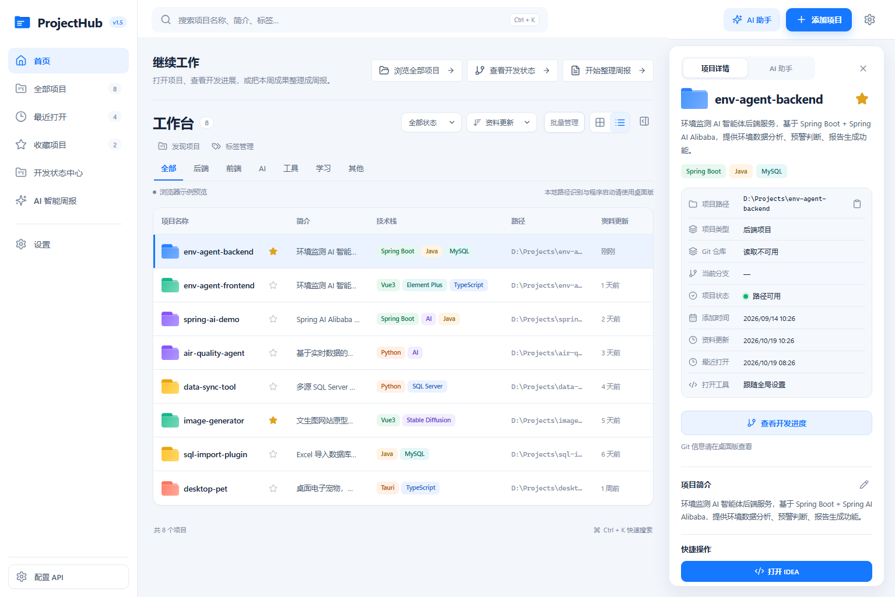
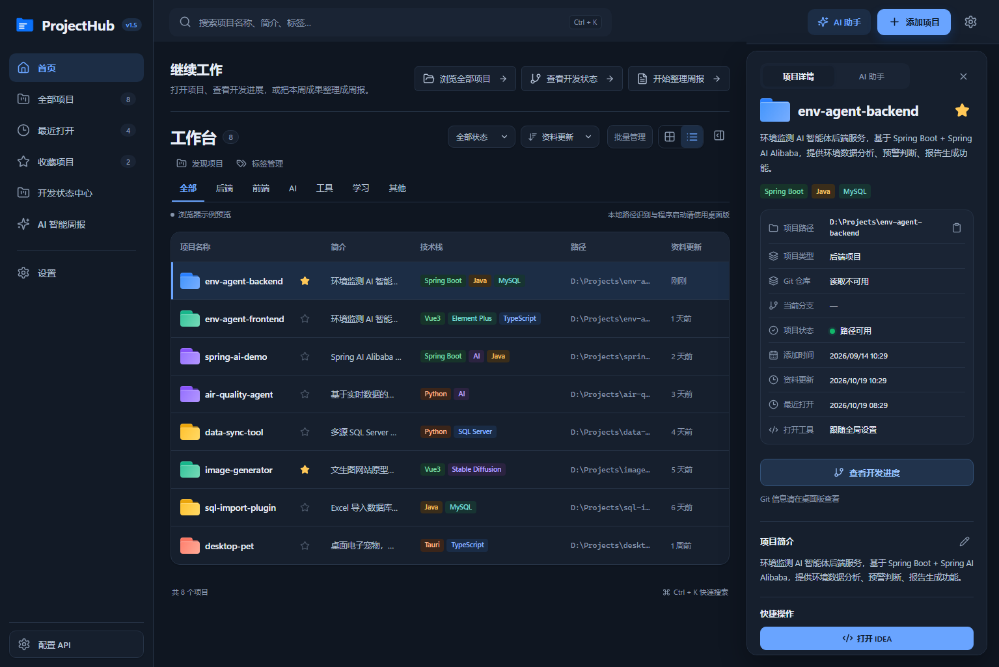
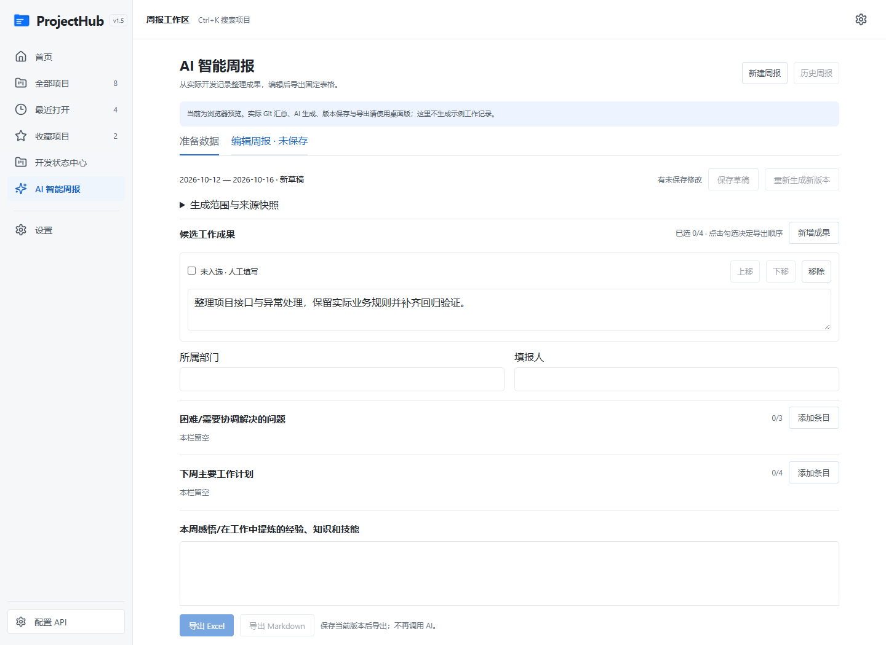

# ProjectHub

**本地项目工作台**：把散落在磁盘各处的项目收进一个可检索的库，串起只读的 Git 开发状态与开发日志，再用 AI 把一周的工作整理成结构化周报。



版本 `v1.5.0` · 平台 Windows x64 · Tauri 2 + React 19 + Rust + SQLite

## 这是什么

ProjectHub 是一个 Windows 桌面应用。项目源码始终留在原处，它只维护一份本地索引，把「有哪些项目、各自是什么状态、这周推进了什么」集中到一处查看。

三条边界写进设计里，不是口头承诺：

- **不自建仓库**：不托管代码，不复制源码，移除项目只删索引。
- **只读 Git**：查询分支、差异、提交历史与活跃度，不提交、不暂存、不还原、不切分支、不推送，也不自动 fetch。
- **不擅自联网**：只有你在预览里核对过收件人、接口、模型与完整发送内容，确认之后才会调用已配置的模型服务。

## 核心能力

### 项目库与检索

- 列表／卡片两种视图，按名称、简介、路径、标签、技术栈检索，`Ctrl + K` 全局搜索；分类、路径状态、资料更新排序可选。
- 一键「发现项目」：指定 1–20 个根目录与 1–4 层扫描深度，预览候选、勾选后批量导入，既有项目不重复录入。
- 批量管理：全选当前搜索结果、收藏、统一分类、确认后移除索引，跨筛选保留选择。
- 标签整理：自定义标签与技术栈分开统计，支持搜索、重命名合并、移除；确认框列出全部受影响项目，失败整批回滚。
- 用 VS Code、IntelliJ IDEA、Cursor、自定义程序、资源管理器或终端打开项目，可查看 README、复制路径。

浅色／深色／跟随系统三种主题，以下是深色下的同一工作台：



### AI 助手

侧栏「AI 助手」在「项目详情／AI 助手」之间切换，三种场景：

| 场景 | 说明 |
|---|---|
| 自然语言检索 | 「帮我找到空气质量预警项目」，从真实项目库返回候选、分类、技术栈与匹配依据 |
| 生成简介 | 先确认读取范围，再生成可编辑建议，保存只更新简介字段 |
| 辅助分类 | 预览每个项目的原分类、建议分类与证据，逐项勾选确认后整批保存 |

首次使用先展示模型服务与发送范围并等待确认；默认只发已保存的名称、简介、分类、技术栈、标签与必要时间，不默认读取全库 README。会话存内存，重启清空，不存储密钥。

### 开发状态中心（只读 Git）

项目工作区分「工作区、提交历史、活跃度、开发日志、任务」五个页签，代码差异在中间区域阅读：

- **Git**：分支、按文件去重的未提交数量、暂存／工作区差异、未跟踪文本预览；30 条分页历史、提交文件与单文件 Diff，合并提交按第一父比较。
- **活跃度**：当前分支、全部作者，按提交者时间与本地自然日／周／月统计，周一起算，最长回看两年。
- **AI 摘要**：选文件 → 核对模型服务与完整请求 → 独立确认发送 → 编辑 → 手动保存开发日志；默认排除环境文件、私钥证书、凭据与二进制。
- **记录管理**：日志与待办／进行中／已完成任务，可关联多条真实提交；移除项目保留记录，在「已移除项目」中查看或重绑。

部分克隆、外部 clean/process 过滤器、子模块等无法安全读取的情形会明确说明原因，截断与未知状态如实标注，不把未读取的数据当成干净或零活动。

### AI 智能周报

左侧进入「AI 智能周报」，选择项目与日期区间，确认本人 Git 姓名／邮箱后汇总提交与开发日志：

- 默认周一至周五，按提交者时间筛选各项目当前分支的提交；开发日志按记录日期筛选，不套 Git 作者规则。
- 点「汇总提交与开发日志」时排除不相关材料，默认只用提交说明、变更文件名和日志；需要代码证据时逐文件勾选 Diff，敏感或二进制正文排除。
- 生成后按功能主题归纳为 4–8 条候选成果（服务端上限 10 条），人工编辑并选最多 4 条按入选顺序导出；困难最多 3 条、下周计划最多 4 条、感悟一段。
- 历史版本保留来源、作者、分支、HEAD、模型与手选 Diff 路径；重新生成先存原稿，再创建未采用的新版本，「采用此版本」才切换，旧稿与人工修改保留。
- 导出内置固定 Excel 表格（保留合并区域、边框、字体，长文本自动行高）或 Markdown；导出不调用 AI，也不提供 Word／自定义模板导入。



单轮硬上限：最多 20 个项目、每仓库扫描 20,000 条提交、纳入 500 条匹配提交、200 条日志、100 个手选 Diff，完整 AI 请求 64 KiB。触达上限时提示减少材料，不静默裁剪；预览 10 分钟过期，配置、HEAD、日志或导入库变化会让旧请求失效，取消后忽略晚到结果。

## 技术栈

| 层 | 选型 |
|---|---|
| 桌面容器 | Tauri 2（Windows，NSIS 打包） |
| 前端 | React 19 · TypeScript 5.9 · Vite |
| 原生层 | Rust（edition 2021，最低 1.77.2） |
| 存储 | SQLite（rusqlite bundled，schema 自动迁移至 v3） |
| 测试 | Vitest + Testing Library（前端）· cargo test（Rust） |

## 快速开始

### 环境要求

- Node.js 22.12+
- 稳定版 Rust 工具链、Microsoft C++ Build Tools（桌面 C++ 工作负载、MSVC、Windows SDK）、WebView2

参考：[Tauri Windows 前置条件](https://v2.tauri.app/start/prerequisites/) · [Rust 安装入口](https://rustup.rs/)

### 浏览器预览

```powershell
npm.cmd install
npm.cmd run dev
```

打开 http://localhost:1420/ 。浏览器模式明确标注「示例预览」，数据写入独立的 localStorage 命名空间；目录校验、文件夹选择器、启动 IDE、SQLite 与备份相关操作会提示需在桌面版使用，不会伪造结果。

### 桌面版

```powershell
npm.cmd install
npm.cmd run desktop
```

首次启动为空项目库；添加真实目录后，可在设置中填写 IDE 的完整可执行文件路径，留空则回退系统 PATH。

### 打包 Windows 安装包

```powershell
npm.cmd test
cargo test --manifest-path src-tauri/Cargo.toml
npm.cmd run package:windows
```

安装包输出到 `src-tauri\target\release\bundle\nsis\`。

## 数据与隐私

- 数据库默认位于 `%APPDATA%\com.projecthub.desktop\projecthub.sqlite`，无需 MySQL 或云服务；实际路径可在设置中查看。
- 备份导出／导入会先校验快照、自动完整备份现库，再在事务中重建表结构并写入；失败保留原库。v1／v2 备份可导入但不含周报历史。
- API Key 在 Windows 下用当前用户 DPAPI 加密，存于应用数据目录 `ai-settings.json`，界面只显示是否已配置，不回显、不写浏览器存储、不进数据库备份。
- 文件识别只读根目录已知配置文件的头部（每文件上限 128 KiB），不递归、不跟随特征文件符号链接、不执行其中的命令；README 以纯文本显示，不渲染 HTML。

## 目录

```text
src/
  components/   卡片、详情、原生 dialog、项目与设置表单、助手与周报界面
  services/     Tauri 调用、浏览器示例仓库、筛选与行为测试
  types/        项目、设置、开发记录与周报类型
  styles/       浅色／深色主题与响应式样式
src-tauri/
  src/commands/ Tauri 命令及本地任务串行化
  src/services/ 目录校验、只读识别、进程启动、Git 读取、AI 调用
  src/db/       SQLite schema、CRUD、备份与事务导入
  icons/        安装图标
docs/           设计文档、实施计划、验收记录与截图
```

## 文档索引

| 入口 | 内容 |
|---|---|
| [版本迭代记录](docs/CHANGELOG.md) | 按版本分节：每轮的新增、优化、修复，以及当轮到底验证到什么程度（v0.1 → v1.5） |
| [ProjectHub 设计文档](ProjectHub设计文档.md) | 最初的整体设计与原型说明 |
| [设计稿与实施计划](docs/superpowers/) | 按版本归档的 spec 与 plan |
| [V1.5 验收记录](docs/2026-10-16-V1.5验收记录.md) | 周报能力的验证证据与范围 |
| [V1.4 验收记录](docs/2026-10-16-V1.4验收记录.md) | 开发状态中心的验证证据 |
| [开发状态中心验收记录](docs/2026-10-16-开发状态中心验收记录.md) | 五个页签的验收结论 |
| [AI 助手验收记录](docs/2026-10-15-AI助手验收记录.md) | 三种助手场景的验证结果 |
| [整体体验优化验收记录](docs/2026-10-16-整体体验优化验收记录.md) | 快捷入口、检索与主题统一 |
| [v0.2 迭代记录](docs/v0.2迭代记录.md) · [v0.3 迭代记录](docs/v0.3迭代记录.md) | 早期版本的范围与已知限制 |
| [Windows 打包记录](docs/Windows打包记录.md) | 打包环境与产物说明 |

## 已知边界

- 仅面向 Windows x64，不做 Linux／macOS 打包。
- 不含通用项目问答、回收站、开机自启与托盘；不虚构目录大小或磁盘占用。
- 项目问答、IDE／终端启动、模块问答与跨项目对比尚未接入对话工具，详情页里的手动打开功能照常可用。
- 完成的是本地模拟接口与表单测试，不等于所有模型供应商都已实测；真实模型需自行配置地址、模型与密钥。
