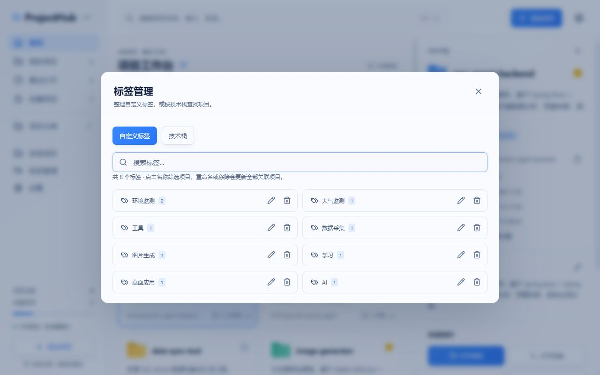

# v0.3 标签整理版：迭代与验收

日期：2026-10-13。npm、lock 根包、Cargo 与 Tauri 版本为 `0.3.0`，界面标记 `v0.3`。数据库结构及 `user_version=1` 保持兼容，未增加依赖。

## 功能

- 自定义标签和技术栈分开统计、搜索和筛选，使用数量按项目去重。
- 自定义标签重命名、合并去重、移除；确认框列出全部受影响项目名称和路径，每次最多 500 条。
- 冻结明确的 ID 清单；失效 ID 或源标签变化时整批失败。仅更新 `tags` 和 `updatedAt`，不改变技术栈、项目路径或源文件。
- SQLite 使用单事务；浏览器持久化成功后替换内存，保存失败可重试。
- 标签和混合来源的当前筛选随操作同步，技术栈来源保持原值。
- 保存期间不能关闭或重复提交；技术栈不提供标签重命名/移除操作。

## 实际验证

| 验证 | 结果与边界 |
| --- | --- |
| `npm.cmd test` | 37/37 通过，5 个测试文件 |
| 仓库测试 | 22 项，覆盖标签合并、移除、明确范围、失效 ID/源标签、存储失败回滚、Unicode 空白和来源筛选，以及既有 CRUD/批量导入等行为 |
| 标签管理组件 | 5 项，覆盖统计、技术栈只读、影响清单、合并提示、确认前不写入、取消、失败重试、忙时保护 |
| 项目表单回归 | 2 项，未改标签/技术栈文本时保留含逗号的原数组；主动修改仍按逗号解析 |
| 主界面回归 | 3 项，混合标签筛选随重命名同步、明确技术栈筛选保持、移除当前自定义标签后清空筛选且保留项目 |
| 扫描组件回归 | 5 项，上一版的选择、取消与导入流程仍通过 |
| 测试先行 | 新增仓库行为先出现 6 项失败，标签组件可加载后出现 5 项交互失败；审查的逗号、旧筛选、NEL/BOM 问题分别复现后修复 |
| `npm.cmd run build` | 最终 TypeScript 严格检查和 Vite 生产构建通过；新增测试中的不支持定位参数由编译检查捕获并修正 |
| 版本一致性 | Python 校验五处版本均为 0.3.0 |
| 独立源码复核 | 三项边界问题修复后复核通过，未发现新的阻断问题；不替代 Rust 编译 |
| Rust | 源码共声明 22 项测试，本轮新增 3 项；**未编译、未执行** |
| 桌面 / 安装包 | **未实测、未生成**；仍缺 Rust/Cargo、MSVC/SDK |

## 浏览器验收

使用独立样例 `v0.3 标签验收`，路径文本 `D:\ProjectHubChecks\TagIteration`，自定义标签为“旧标签/已有标签”，技术栈为“旧标签”。浏览器不验证或访问该路径。

1. 重命名确认框列出该项目及路径，输入已有标签时出现合并提示。
2. 确认合并后刷新，标签搜索只有一条“已有标签”，数量为 1。
3. 取消移除后重新进入确认，再执行移除；自定义标签消失。
4. 技术栈中“旧标签”仍存在，精确筛选仍返回验收项目；详情显示暂无自定义标签。
5. 清理独立样例并刷新，恢复原有 8 个示例项目，无验收标签残留。

最终标签管理界面截图：

## 名称与编辑规则

标签区分大小写；目标名称去首尾 Unicode White_Space 与 BOM，非空且不超过 80 个 Unicode 码点。JavaScript 使用 `\s` 加 U+0085，Rust 使用 `is_whitespace` 加 U+FEFF，避免两端默认 `trim` 的差异。重命名到已有名称时按首次出现顺序去重。

标签名称可以包含逗号。项目资料表单中未修改的标签/技术栈文本会保留原数组，避免编辑其他字段时静默拆分。主动更改该文本时依旧按中英文逗号分隔，此编辑规则在 README 中说明。

## 后续桌面验收

补齐工具链后执行 `cargo test --manifest-path src-tauri/Cargo.toml`，重点验证合并/移除保留技术栈与源文件、失效记录导致事务回滚、NEL/BOM 规范化。再在独立 SQLite 项目库中测试写锁/磁盘错误、离线路径、重启持久化，并构建和安装 NSIS 包。
